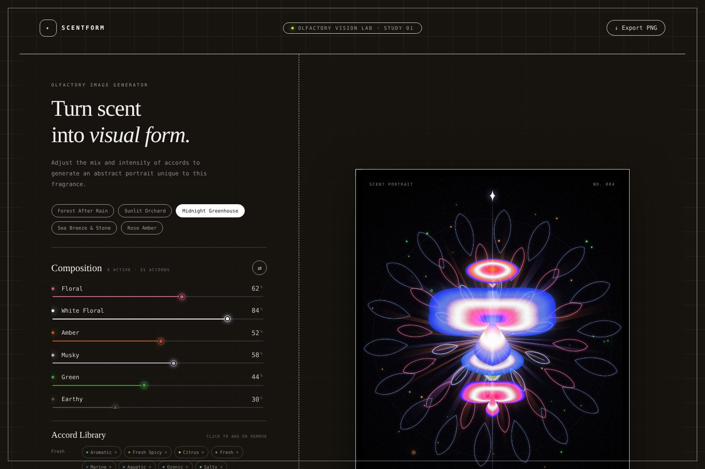

# Scentform

**Turn scent into visual form.** Scentform is a tiny browser app that turns a fragrance’s accords and their intensities into an abstract, iridescent “scent portrait.”

**▶ Try it: https://encorechun.github.io/scentform/**

## How it works

Pick a preset, or build a recipe from the accord library and drag the sliders to set each accord’s intensity. The portrait redraws instantly.

Every accord becomes one unit in a vertical totem. Its category decides the shape and adds a light effect around the totem:

| Category | Unit shape | Light effect |
|---|---|---|
| Fresh | four-point star | vertical waveforms running along the axis |
| Floral | winged petal | a line-drawn rosette around the center |
| Warm | spinning top | radiant rays and a glowing white core |
| Natural | leaf | scattered glowing spores |

Proportions matter:

- Intensities are rescaled within each recipe (weakest → 0, strongest → 1) and squared, so the dominant accords read as the main forms.
- Each light effect’s strength follows its category’s share of the whole recipe, so a mostly-woody scent is mostly rays and a mostly-fresh scent is mostly waves.

Same recipe + same number = same image. Hit **Regenerate form** for a new arrangement, and **Export PNG** to download a 1000 × 1250 image.

Accord names and colors follow the “main accords” used on [Fragrantica](https://www.fragrantica.com), so you can copy a perfume’s accord bars straight into the sliders.

## Run locally

It’s a single, dependency-free HTML file. Download `index.html` and open it in a browser.

## License

[MIT](LICENSE) © Chunfeng Yang
